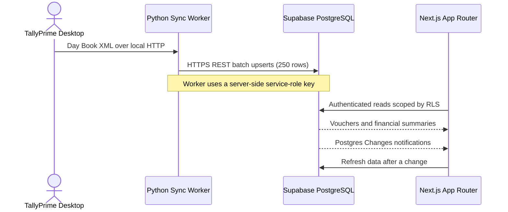

<div align="center">
  
  <h1>FINORA | Tally Client Reporting Portal</h1>
  <p>A role-based reporting workspace connecting desktop TallyPrime data to Supabase and Next.js.</p>

  <a href="https://github.com/arjunpv1312/tally-client-portal/actions/workflows/ci.yml">
    
  </a>
  <a href="./LICENSE">
    
  </a>
  
  
  
  
</div>

> **Demo:** No hosted demo is currently configured. Use the local setup below with a development Supabase project and synthetic data.

**Quick links:** [Architecture](#system-architecture) · [Security](#architecture-and-security-matrix) · [Quickstart](#quickstart) · [TallyPrime sync](#tallyprime-connection-protocol) · [Contributing](./CONTRIBUTING.md) · [Compliance notes](./COMPLIANCE.md)

## Executive overview

Tally Client Reporting Portal is a cloud reporting workspace for accounting practices and their clients. A trusted machine can read accounting data from desktop TallyPrime over its local XML/HTTP interface and send validated records to Supabase. The Next.js portal then provides a separate, role-aware experience for administrators, employees, and client companies.

The web application includes administrator-managed company and account directories, employee-to-company assignments, authentication, and a read-only financial dashboard. Supabase Row Level Security (RLS) is the database access boundary; the browser never connects directly to TallyPrime. Supabase SSR cookies and the Next.js `proxy.ts` convention provide authenticated, role-checked access to protected route paths, while RLS remains authoritative for database access.

> The portal includes a local `tally_sync.py` worker and schema for vouchers and monthly summaries. Configure the sync environment and apply the updated schema before connecting a live TallyPrime company.

## System architecture



The Tally listener should remain on a trusted local network and must not be
exposed directly to the public internet. The sync worker uses a service-role
key for writes; this key bypasses RLS and must be kept on the trusted sync
machine. Admin API routes also use the key server-side after verifying the
requesting administrator. Never place it in browser code or a `NEXT_PUBLIC_`
variable.

## Architecture and security matrix

| Tier | Implementation | Evidence and limits |
| --- | --- | --- |
| Authentication and roles | Supabase Auth, profiles, and role-checked Next.js routes | `proxy.ts` enforces route roles; privileged admin APIs independently verify the access token and admin profile. Route checks do not replace database authorization. |
| Tenant data access | PostgreSQL Row Level Security | [`supabase/schema.sql`](./supabase/schema.sql) enables RLS and defines user/company/employee and admin policies for the current tables. Test policies against the deployed schema and every role. |
| Tally data ingestion | Python standard-library worker using TallyPrime XML/HTTP and Supabase REST | Upserts batches of 250 records. Unique constraints cover `(company_id, tally_voucher_id)` and `(company_id, period_start)`; this provides idempotent keys for those records. |
| Database | PostgreSQL tables, foreign keys, constraints, and indexes | Current schema defines profiles, companies, assignments, vouchers, and summaries. It does not currently define an audit-log table, automatic summary triggers, or `v_company_voucher_totals` view. |
| Frontend | Next.js 16 App Router, React 19, TypeScript, Tailwind CSS, Framer Motion, Recharts | Dashboard subscribes to Supabase Postgres Changes and refreshes data using the authenticated client. This is not a claim that all charts are code-split or that the UI has been independently audited. |
| Privacy and cryptography | Deployment-dependent | Hosting, TLS versions, encryption at rest, backup retention, and region depend on the configured providers. See [COMPLIANCE.md](./COMPLIANCE.md); this repository does not certify DPDP/GDPR compliance or a particular cipher suite. |

### Key capabilities

- Role-aware admin, employee, and client-company workspaces; no public
  self-registration.
- Company-scoped access policies for financial summaries and vouchers.
- Dashboard visualizations for sales, purchases, expenses, net profit, and GST
  values, including CGST/SGST/IGST values where Tally data is available.
- Supabase Postgres Changes subscriptions to refresh client dashboards after
  voucher or summary changes.
- Idempotent sync upserts using database uniqueness constraints.

The repository does not currently implement a dedicated audit-log system.
RLS, CI checks, and governance documents are controls and process evidence, not
an independent security audit or compliance certification. See
[`SECURITY.md`](./SECURITY.md) for disclosure guidance and known boundaries.

## Roles and authorization

| Capability | Admin | Employee | Client company |
| --- | :---: | :---: | :---: |
| Manage companies | Yes | — | — |
| Create employee and client accounts | Yes | — | — |
| Assign employees to companies | Yes | — | — |
| View company and account directories | Yes | — | — |
| View assigned company workspace | — | Yes | — |
| View own company financial dashboard | — | — | Yes |
| Public self-registration | No | No | No |

The login screen asks the user to select Admin, Employee, or Client. The selected tab is checked against the signed-in user's `profiles.role`; successful sessions are routed to `/admin`, `/employee`, or `/dashboard`. Database RLS policies remain authoritative even when a route is hidden or guarded in the UI.

Authenticated sessions display an inactivity warning after 25 minutes and sign out locally after 30 minutes without activity. Mouse movement, keyboard input, scrolling, touch, or a click resets the idle timer. This is a client-side session convenience and does not replace server-side authorization or the Supabase session's own expiry.

## Technology

| Category | Implementation |
| --- | --- |
| Framework | Next.js 16 App Router, React 19, TypeScript 5 |
| Styling and UI | Tailwind CSS 4, CSS theme tokens, Lucide React |
| Motion and feedback | Framer Motion, Sonner toast notifications |
| Database | Supabase PostgreSQL with Row Level Security |
| Authentication | Supabase Auth; administrator-provisioned accounts |
| Charts | Recharts sales, expense, profit, and GST visualizations |
| Sync engine | Python standard library, TallyPrime XML/HTTP on port `9000`, Supabase REST upserts |

## Quickstart

### Prerequisites

- Node.js LTS and npm
- A Supabase project with access to its SQL Editor
- TallyPrime and Python 3.10+ only when configuring the local integration

### 1. Clone and install

```bash
git clone https://github.com/arjunpv1312/tally-client-portal.git
cd tally-client-portal
npm install
```

### 2. Configure environment

Create `.env.local` in the repository root:

```dotenv
NEXT_PUBLIC_SUPABASE_URL=https://<project-ref>.supabase.co
NEXT_PUBLIC_SUPABASE_ANON_KEY=<supabase-anon-or-publishable-key>
SUPABASE_SERVICE_ROLE_KEY=<server-only-service-role-key>
```

The browser uses the public project URL and anon/publishable key. The service-role key is used only by the admin account-provisioning API route. Keep it server-side, out of source control, and out of all `NEXT_PUBLIC_` variables. Restart the dev server after changing environment variables.

### 3. Initialize Supabase

1. Open the Supabase project **SQL Editor**.
2. Run [`supabase/schema.sql`](./supabase/schema.sql). It creates profile, company, employee-assignment, voucher, and financial-summary structures and configures RLS policies. Re-running the SQL safely adds the reporting tables and policies.
3. In **Authentication → Users**, create the first administrator.
4. Copy the new Auth user's UUID, then run the bootstrap `INSERT` at the end of `schema.sql` with that UUID, email, and an administrator display name.
5. Sign in at `/login` using the Admin role tab.

Do not disable RLS to make the UI work. Create and review policies whenever adding data tables or access paths.

### 4. Start the application

```bash
npm run dev
```

Open [http://localhost:3000](http://localhost:3000). There is no public sign-up form. Administrators create employee and client accounts from the admin workspace.

Useful checks:

```bash
npm run lint
npx tsc --noEmit
npm run build
```

## TallyPrime connection protocol

### Enable the local XML/HTTP listener

1. Open the target company in TallyPrime and enable its HTTP/XML server in the connectivity settings. Menu labels vary by TallyPrime release.
2. Set the listener port to **9000**.
3. On the same machine that will run the sync, confirm TallyPrime is reachable at `http://localhost:9000`.
4. Ensure the local firewall permits the sync process. Do **not** port-forward this listener or expose it to the public internet.

### Find the FINORA company ID

In FINORA, sign in as an administrator and find the company in the **Companies** tab. Use its database UUID as `TALLY_COMPANY_ID`; do not use the company name in that field. The UUID identifies the company row used to associate synced vouchers and summaries.

### Configure and run `tally_sync.py`

Create a `.env` file next to `tally_sync.py` from [`.env.example`](./.env.example). The launcher can create it for you. Set the following values:

```dotenv
SUPABASE_URL=https://<project-ref>.supabase.co
SUPABASE_SERVICE_ROLE_KEY=<server-only-service-role-key>
TALLY_HOST=http://localhost:9000
TALLY_COMPANY_ID=<company-uuid-from-the-FINORA-Companies-tab>
TALLY_COMPANY_NAME=<exact-company-name-open-in-TallyPrime>
TALLY_EXPENSE_LEDGER_NAMES=Office Rent,Professional Fees
```

The sync worker reads `.env` without requiring an additional Python package; already-set process environment variables take precedence. `TALLY_HOST` defaults to `http://localhost:9000`. Use `TALLY_COMPANY_ID` for the company UUID; `TARGET_COMPANY_ID` is not read. The worker also requires the exact open Tally company name in `TALLY_COMPANY_NAME`.

The service-role key bypasses RLS. Keep it only in the trusted sync computer's ignored `.env` file or another protected secret store; never share it through the Admin UI, commit it, or include it in screenshots or chat. The sync URL must use HTTPS except for local development Supabase.

`TALLY_EXPENSE_LEDGER_NAMES` is an explicit comma-separated allowlist of Tally ledgers used to classify payment entries as expenses. Payment vouchers are **not** assumed to be expenses because they may settle purchases or liabilities. Configure the ledger names to match the Tally company; otherwise payment expense totals remain zero. Purchase amounts are reported separately from classified payment expenses to avoid automatically double-counting purchase settlements.

Optional range and network controls are `TALLY_SYNC_FROM_DATE` (`YYYY-MM-DD`, defaults to the current Indian financial-year start), `TALLY_SYNC_TO_DATE` (defaults to today), `TALLY_SYNC_RETRIES` (defaults to 3), and `TALLY_SYNC_TIMEOUT` (defaults to 30 seconds).

Run the sync manually after enabling Tally's local XML/HTTP listener:

```powershell
py -3 .\tally_sync.py
```

Or on Windows, double-click [`run_sync.bat`](./run_sync.bat). On first run it creates `.env` from `.env.example` and opens it for configuration. Save the settings and run the launcher again.

On success, the worker prints a line in this format:

```text
Tally sync complete: <voucher-count> vouchers and <summary-count> monthly summaries upserted.
```

The worker exports the Day Book from `http://localhost:9000`, validates XML and dates, upserts vouchers on `(company_id, tally_voucher_id)`, then upserts monthly summaries. Network failures are retried; credentials and voucher payloads are not printed. Re-running the sync uses the database uniqueness constraints to update existing records rather than creating duplicate vouchers.

### Verify data in FINORA

1. In Supabase, verify that `vouchers` and `financial_summaries` contain rows for the configured `company_id`.
2. Sign in to FINORA as a **Client** account whose `profiles.company_id` matches that company, then open `/dashboard`. Employee accounts use `/employee`; the client financial dashboard is for company-role accounts.
3. Check that the metric cards, charts, and recent vouchers show the imported data. Summary values depend on the source vouchers and configured expense ledgers.
4. Keep `/dashboard` open and run the sync again. The dashboard subscribes to Supabase Postgres Changes and refreshes when voucher or summary records change. This requires the Supabase Realtime publication/configuration to include the relevant tables.

Register a daily 3:00 AM Task Scheduler job from PowerShell:

```powershell
.\scripts\schedule_sync.ps1
```

The generated task uses the current user's `python` executable. For scheduled runs, configure persistent user-level environment variables for the same Windows account (rather than only setting variables in a temporary PowerShell session). Review the task and run it manually once before relying on the schedule.

The financial summary is calculated from sales and purchase voucher net amounts, tax ledger lines containing `CGST`, `SGST`, and `IGST`, and only the explicitly configured payment-expense ledgers. Validate the Tally Day Book export and ledger mapping against company books before using the figures for statutory reporting.

Never place a service-role key in the script source, browser bundle, or a checked-in configuration file.

### Local tests and mock server

The repository includes Python unit tests for XML parsing, voucher classification, and summary calculations:

```powershell
py -3 -m unittest discover -s tests -p "test_*.py"
```

These tests use local fixtures and do not connect to TallyPrime or Supabase. A `scripts/mock_tally_server.py` is not currently included, so the two-terminal mock-server procedure requires a separate mock server and is not runnable from this repository as-is.

## Non-Technical Setup Guide (For Business Owners & Accountants)

You do not need Supabase dashboard access to find your company identifier or run an already-configured FINORA sync. An administrator must securely provision the sync computer with the Supabase service-role key; FINORA never displays or copies this privileged secret in the Admin Portal.

### Step 1: Get your Company ID and project settings

1. Sign in to your FINORA Admin Portal (for example, `https://your-portal-domain.com/admin`).
2. Open the **Companies** tab.
3. Use **Copy ID** beside your company. The full UUID is copied to your clipboard.
4. Use **Copy Project Config** at the top of the Admin page for the public Supabase URL and the local Tally endpoint.

### Step 2: Configure local sync

1. On the computer that runs TallyPrime, open the FINORA sync project folder.
2. Double-click `run_sync.bat`. On first launch, it creates `.env` from `.env.example` and opens the file.
3. Set `SUPABASE_URL` and `TALLY_HOST` from the copied project config.
4. Paste the Company ID into `TALLY_COMPANY_ID` (not `TARGET_COMPANY_ID`).
5. Enter the exact company name open in TallyPrime as `TALLY_COMPANY_NAME`.
6. Ask your system administrator to provision `SUPABASE_SERVICE_ROLE_KEY` securely on this computer. Never paste this secret into the Admin Portal, a public issue, or a chat.
7. Save `.env`. It is ignored by Git and must not be sent to anyone.

### Step 3: Run and verify sync

1. Open the correct company in TallyPrime and ensure its XML/HTTP service is running on port `9000`.
2. Double-click `run_sync.bat` again. The window reports a success count or an error to help troubleshoot.
3. A client account linked to the same company can open `/dashboard` to view its financial reports. For configuration and troubleshooting, see [TallyPrime connection protocol](#tallyprime-connection-protocol).

Do not expose TallyPrime's local HTTP listener to the public internet. If the launcher reports an error, ask the administrator to verify the local `.env`, the company UUID, and that TallyPrime is open on the sync computer.

## Repository layout

```text
tally-client-portal/
├── .env.example                      # Safe template for local Tally sync configuration
├── .github/workflows/ci.yml          # TypeScript, lint, sync tests, and build checks
├── app/
│   ├── admin/page.tsx                 # Company, account, and assignment management
│   ├── api/admin/create-user/route.ts # Server-side account provisioning
│   ├── dashboard/page.tsx             # Client financial dashboard (live Supabase data)
│   ├── employee/page.tsx              # Employee's assigned companies and entry status
│   ├── login/page.tsx                 # Login and role selection
│   ├── error.tsx                      # Animated route error boundary
│   ├── loading.tsx                    # Animated loading skeleton
│   ├── not-found.tsx                  # Executive 404 page
│   ├── globals.css                    # Global styles and theme variables
│   └── layout.tsx                     # Root layout and app providers
├── components/                        # Shared auth, charts, navigation, and UI
├── lib/                               # Supabase client, theme, and auth helpers
├── proxy.ts                           # SSR session refresh and role-gated routes
├── public/                            # Static app assets (favicon only)
├── scripts/                           # Windows sync scheduling
├── supabase/
│   └── schema.sql                     # Tables, relationships, and RLS policies
├── run_sync.bat                       # Windows one-click sync launcher
├── tally_sync.py                      # TallyPrime to Supabase sync worker
├── tests/test_tally_sync.py            # XML parsing and summary tests
├── types/                             # Shared TypeScript types
├── APP_SPEC.md                        # Product requirements and design rules
└── README.md
```

## License

Distributed under the Apache License 2.0. See [`LICENSE`](./LICENSE).
